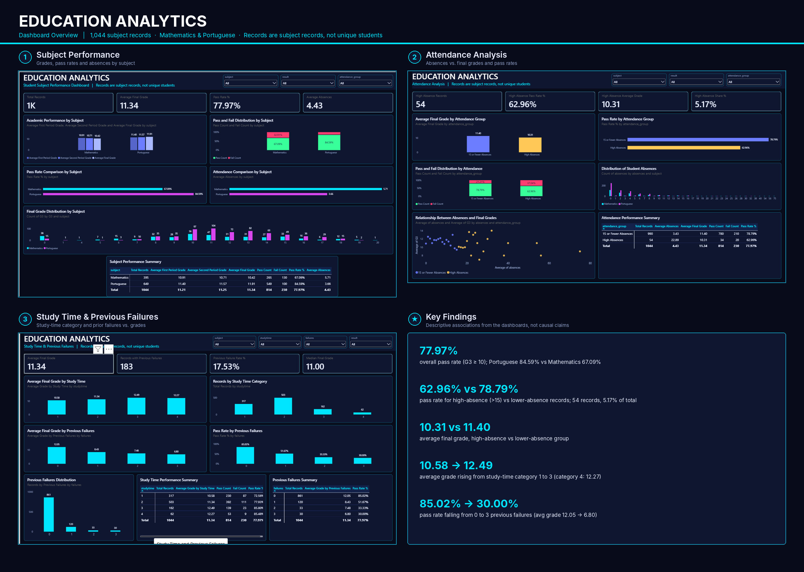
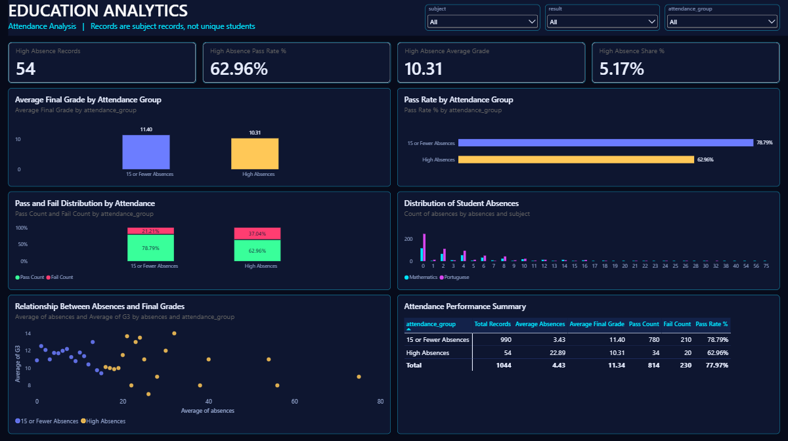
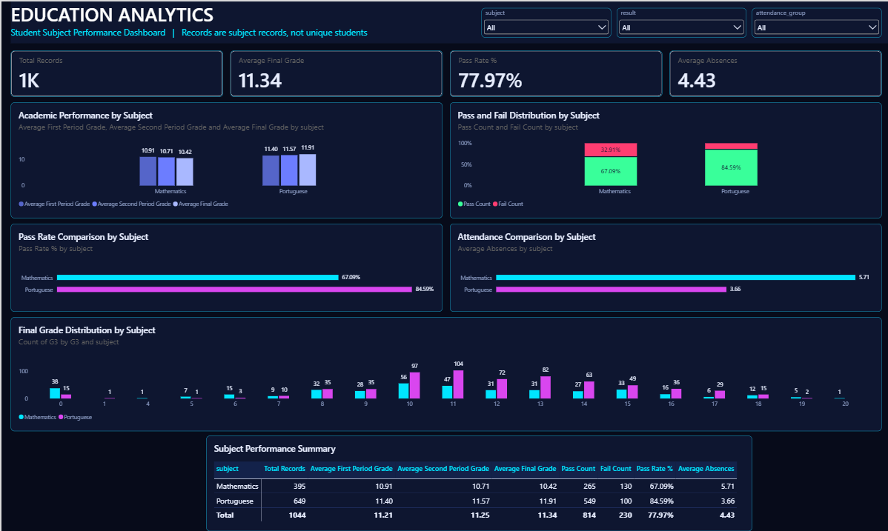
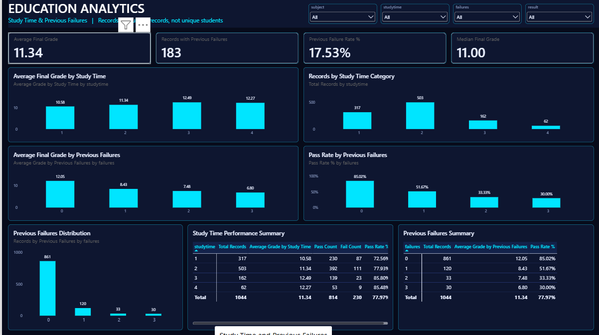

# Power BI Dashboard Documentation

[← Back to README](../README.md) · Report file: [`PowerBI/Education_Analytics_Dashboard.pbix`](../PowerBI/Education_Analytics_Dashboard.pbix)

---

## 1. Power BI Project Overview

| Item | Detail |
|---|---|
| Tool | Power BI Desktop |
| Report | `Education_Analytics_Dashboard.pbix` |
| Data table | `Education_Cleaned_Data` (single table) |
| Records | 1,044 subject records (395 Mathematics + 649 Portuguese) |
| Columns | 36 |
| Pages | 3 – Subject Performance, Attendance Analysis, Study Time and Previous Failures |
| Canvas | 1920 × 1080 (16:9), Fit to page |
| Logic and styling | DAX measures, Segoe UI typography, custom colour theme |

> Every record is a **subject record**, not a unique student. The dataset has no reliable unique student identifier, so no visual or KPI claims to count individual students.

## 2. Dataset Import

The cleaned dataset exported from Python was imported from CSV (**Import** storage mode):

1. **Get data → Text/CSV** → `PowerBI/Education_Cleaned_Data.csv`
2. Power Query promoted the first row to headers and applied column data types.
3. The query was loaded to the model as `Education_Cleaned_Data`.

If the file is moved, update the path in **Home → Transform data → Data source settings → Change Source**, then click **Refresh**.

## 3. Data Modelling

- The model contains **one table** and **no relationships**. All dashboards are built from `Education_Cleaned_Data`.
- All KPIs and chart values are **DAX measures** or standard aggregations of the imported columns. No expected values were typed into any visual.
- The numeric columns `studytime`, `failures` and `absences` are set to **Don't summarize** so they behave as categories on chart axes rather than being auto-summed.
- `studytime` and `failures` are sorted in ascending numerical order on all visuals.

## 4. Data Types

| Data type | Columns |
|---|---|
| Whole number | `age`, `Medu`, `Fedu`, `traveltime`, `studytime`, `failures`, `famrel`, `freetime`, `goout`, `Dalc`, `Walc`, `health`, `absences`, `G1`, `G2`, `G3` |
| Text | `school`, `sex`, `address`, `famsize`, `Pstatus`, `Mjob`, `Fjob`, `reason`, `guardian`, `schoolsup`, `famsup`, `paid`, `activities`, `nursery`, `higher`, `internet`, `romantic`, `subject`, `result`, `attendance_group` |

## 5. DAX Measures and Explanations

All formulas below are copied from the model. Passing condition: **G3 ≥ 10**.

### 5.1 Core measures

```DAX
Total Records = COUNTROWS(Education_Cleaned_Data)
```
Number of subject records in the current filter context. Format: whole number.

```DAX
Average Final Grade = AVERAGE(Education_Cleaned_Data[G3])
```
Mean final grade. Format: 0.00.

```DAX
Average First Period Grade  = AVERAGE(Education_Cleaned_Data[G1])
Average Second Period Grade = AVERAGE(Education_Cleaned_Data[G2])
```
Mean G1 and G2. Format: 0.00.

```DAX
Median Final Grade = MEDIAN(Education_Cleaned_Data[G3])
```
Middle final grade; less affected by extreme values than the mean. Format: 0.00.

```DAX
Total Absences   = SUM(Education_Cleaned_Data[absences])
Average Absences = AVERAGE(Education_Cleaned_Data[absences])
```
Total and mean absences. Format: whole number and 0.00.

### 5.2 Pass/fail measures

```DAX
Pass Count =
CALCULATE(
    COUNTROWS(Education_Cleaned_Data),
    Education_Cleaned_Data[result] = "Pass"
)

Fail Count =
CALCULATE(
    COUNTROWS(Education_Cleaned_Data),
    Education_Cleaned_Data[result] = "Fail"
)
```
Records with `result` equal to Pass or Fail.

```DAX
Pass Rate % =
DIVIDE(
    CALCULATE(
        COUNTROWS(Education_Cleaned_Data),
        Education_Cleaned_Data[G3] >= 10
    ) * 100,
    COUNTROWS(Education_Cleaned_Data),
    0
)
```
Share of records with G3 ≥ 10, expressed on a 0–100 scale and displayed with a "%" suffix (format `0.00"%"`).

```DAX
Fail Rate % =
DIVIDE([Fail Count], [Total Records], 0)
```
Share of failing records (0–1 scale, format 0.00%). Defined in the model as a supporting measure.

```DAX
Grade 10 or Above Count =
CALCULATE([Total Records], Education_Cleaned_Data[G3] >= 10)
```
Records at or above the pass mark. Supporting measure.

> **Scale note:** `Pass Rate %` is stored on a 0–100 scale with a literal "%" in its format, while the share and rate measures in Sections 5.4 and 5.5 use a 0–1 scale with a true percentage format. Both display correctly (for example 78.79%), but the two types are not mixed inside the same visual.

### 5.3 Subject measures

```DAX
Mathematics Records = CALCULATE([Total Records], Education_Cleaned_Data[subject] = "Mathematics")
Portuguese Records  = CALCULATE([Total Records], Education_Cleaned_Data[subject] = "Portuguese")

Mathematics Average Grade = CALCULATE([Average Final Grade], Education_Cleaned_Data[subject] = "Mathematics")
Portuguese Average Grade  = CALCULATE([Average Final Grade], Education_Cleaned_Data[subject] = "Portuguese")

Subject Grade Difference = [Portuguese Average Grade] - [Mathematics Average Grade]
```
Supporting measures for subject-level comparison (Portuguese minus Mathematics mean G3).

### 5.4 Attendance measures

```DAX
High Absence Records =
CALCULATE([Total Records], Education_Cleaned_Data[attendance_group] = "High Absences")

Low Absence Records =
CALCULATE([Total Records], Education_Cleaned_Data[attendance_group] = "15 or Fewer Absences")

High Absence Average Grade =
CALCULATE([Average Final Grade], Education_Cleaned_Data[attendance_group] = "High Absences")

Low Absence Average Grade =
CALCULATE([Average Final Grade], Education_Cleaned_Data[attendance_group] = "15 or Fewer Absences")

High Absence Pass Rate % =
CALCULATE([Pass Rate %], Education_Cleaned_Data[attendance_group] = "High Absences")

High Absence Share % =
DIVIDE([High Absence Records], [Total Records], 0)
```

### 5.5 Study-time and previous-failure measures

```DAX
Average Grade by Study Time        = AVERAGE(Education_Cleaned_Data[G3])
Average Grade by Previous Failures = AVERAGE(Education_Cleaned_Data[G3])
Records by Previous Failures       = COUNTROWS(Education_Cleaned_Data)

Records with Previous Failures =
CALCULATE([Total Records], Education_Cleaned_Data[failures] > 0)

Previous Failure Rate % =
DIVIDE([Records with Previous Failures], [Total Records], 0)

Average Grade No Failures =
CALCULATE([Average Final Grade], Education_Cleaned_Data[failures] = 0)

Average Grade With Failures =
CALCULATE([Average Final Grade], Education_Cleaned_Data[failures] > 0)
```
`Average Grade by Study Time`, `Average Grade by Previous Failures` and `Records by Previous Failures` use the same expressions as the base measures; the breakdown comes from the category placed on the visual's axis (`studytime` or `failures`). They are named separately so each chart's purpose is clear in the field list.

### 5.6 Other supporting measures in the model

```DAX
Maximum Final Grade = MAX(Education_Cleaned_Data[G3])
Minimum Final Grade = MIN(Education_Cleaned_Data[G3])
```
Defined in the model; not used on a dashboard page.

## 6. KPI Definitions

| Page | KPI card | Measure | Definition | Value (no slicers) |
|---|---|---|---|---:|
| 1 | Total Records | `Total Records` | Number of subject records | 1,044 |
| 1 | Average Final Grade | `Average Final Grade` | Mean G3 | 11.34 |
| 1 | Pass Rate % | `Pass Rate %` | Share of records with G3 ≥ 10 | 77.97% |
| 1 | Average Absences | `Average Absences` | Mean absences per record | 4.43 |
| 2 | High Absence Records | `High Absence Records` | Records with more than 15 absences | 54 |
| 2 | High Absence Pass Rate % | `High Absence Pass Rate %` | Pass rate within the high-absence group | 62.96% |
| 2 | High Absence Average Grade | `High Absence Average Grade` | Mean G3 within the high-absence group | 10.31 |
| 2 | High Absence Share % | `High Absence Share %` | High-absence records ÷ total records | 5.17% |
| 3 | Average Final Grade | `Average Final Grade` | Mean G3 | 11.34 |
| 3 | Records with Previous Failures | `Records with Previous Failures` | Records with at least one previous failure | 183 |
| 3 | Previous Failure Rate % | `Previous Failure Rate %` | Records with previous failures ÷ total records | 17.53% |
| 3 | Median Final Grade | `Median Final Grade` | Median G3 | 11.00 |

---

## 7. Dashboard Page 1 – Subject Performance

**Purpose:** give a high-level view of overall performance and compare Mathematics and Portuguese.

**Analytical questions answered**

- How many records are analysed and what is the overall pass rate?
- How do Mathematics and Portuguese compare on grades, pass rate and absences?
- How do grades change from the first to the final period in each subject?

| # | Visual | Type | Field assignments |
|---|---|---|---|
| – | KPI cards (4) | Card | `Total Records`, `Average Final Grade`, `Pass Rate %`, `Average Absences` |
| 1 | Academic Performance by Subject | Clustered column | Axis: `subject`; Values: `Average First Period Grade`, `Average Second Period Grade`, `Average Final Grade` |
| 2 | Pass and Fail Distribution by Subject | 100% stacked column | Axis: `subject`; Values: `Pass Count`, `Fail Count` |
| 3 | Pass Rate Comparison by Subject | Clustered bar | Axis: `subject`; Values: `Pass Rate %` |
| 4 | Final Grade Distribution by Subject | Clustered column | Axis: `G3`; Legend: `subject`; Values: Count of `G3` |
| 5 | Attendance Comparison by Subject | Clustered bar | Axis: `subject`; Values: `Average Absences` |
| 6 | Subject Performance Summary | Matrix | Rows: `subject`; Values: `Total Records`, `Average First Period Grade`, `Average Second Period Grade`, `Average Final Grade`, `Pass Count`, `Fail Count`, `Pass Rate %`, `Average Absences` |

**Slicers:** `subject`, `result`, `attendance_group`.

## 8. Dashboard Page 2 – Attendance Analysis

**Purpose:** analyse how absences are associated with academic performance.

**Analytical questions answered**

- How many records are in the high-absence group and what share of the data do they represent?
- Do high-absence records have lower grades and pass rates?
- How are absences distributed, and how does grade vary with absences?

| # | Visual | Type | Field assignments |
|---|---|---|---|
| – | KPI cards (4) | Card | `High Absence Records`, `High Absence Pass Rate %`, `High Absence Average Grade`, `High Absence Share %` |
| 1 | Average Final Grade by Attendance Group | Clustered column | Axis: `attendance_group`; Values: `Average Final Grade` |
| 2 | Pass Rate by Attendance Group | Clustered bar | Axis: `attendance_group`; Values: `Pass Rate %` |
| 3 | Pass and Fail Distribution by Attendance | 100% stacked column | Axis: `attendance_group`; Values: `Pass Count`, `Fail Count` |
| 4 | Distribution of Student Absences | Clustered column | Axis: `absences`; Legend: `subject`; Values: Count of `absences` |
| 5 | Relationship Between Absences and Final Grades | Scatter | Details: `absences`; X: Average of `absences`; Y: Average of `G3`; Legend: `attendance_group` |
| 6 | Attendance Performance Summary | Matrix | Rows: `attendance_group`; Values: `Total Records`, `Average Absences`, `Average Final Grade`, `Pass Count`, `Fail Count`, `Pass Rate %` |

**Slicers:** `subject`, `result`, `attendance_group`.

**Interpretation notes**

- The scatter chart plots **aggregated points** (average G3 for each distinct absence value within each attendance group). A point is not an individual student.
- The four High Absence KPI cards show blank or zero when a slicer excludes the high-absence group. This is expected behaviour.

## 9. Dashboard Page 3 – Study Time and Previous Failures

**Purpose:** explore how study-time category and previous academic failures relate to final grades and pass rates.

**Analytical questions answered**

- How do average grades and record counts differ across study-time categories?
- How many records have previous failures?
- How do grades and pass rates change as previous failures increase?

| # | Visual | Type | Field assignments |
|---|---|---|---|
| – | KPI cards (4) | Card | `Average Final Grade`, `Records with Previous Failures`, `Previous Failure Rate %`, `Median Final Grade` |
| 1 | Average Final Grade by Study Time | Clustered column | Axis: `studytime`; Values: `Average Grade by Study Time` |
| 2 | Records by Study Time Category | Clustered column | Axis: `studytime`; Values: `Total Records` |
| 3 | Average Final Grade by Previous Failures | Clustered column | Axis: `failures`; Values: `Average Grade by Previous Failures` |
| 4 | Pass Rate by Previous Failures | Clustered column | Axis: `failures`; Values: `Pass Rate %` |
| 5 | Previous Failures Distribution | Clustered column | Axis: `failures`; Values: `Records by Previous Failures` |
| 6 | Study Time Performance Summary | Matrix | Rows: `studytime`; Values: `Total Records`, `Average Grade by Study Time`, `Pass Count`, `Fail Count`, `Pass Rate %` |
| 7 | Previous Failures Summary | Matrix (additional) | Rows: `failures`; Values: `Total Records`, `Average Grade by Previous Failures`, `Pass Rate %` |

**Slicers:** `subject`, `studytime`, `failures`, `result`.

`studytime` values are **ordinal category codes (1–4), not hours**, and all axes are sorted in ascending numerical order.

---

## 10. Slicers and Interactions

- Slicers use the **dropdown** style and sit in the header band at the top right of each page.
- Slicers on each page filter all KPI cards, charts and matrices on that page.
- Standard Power BI **cross-filtering** between visuals is used (selecting a bar or matrix row filters the other visuals). Custom edit-interaction rules were not applied.
- Each slicer applies to the page it sits on.

## 11. Colour Theme

A dark navy theme with cyan, magenta and semantic pass/fail colours, applied consistently across all three pages.

| Element | Colour |
|---|---|
| Page background | `#070B1A` |
| Header band | `#050A1E` |
| Header accent line / Mathematics | `#00E5FF` (cyan) |
| Card and visual background | `#0E1630` |
| Visual border | `#169BBF` |
| Portuguese | `#D946EF` (magenta) |
| Pass | `#39FF9A` (green) |
| Fail | `#FF3D71` (red) |
| 15 or Fewer Absences | `#6C7DFF` (indigo) |
| High Absences | `#FFC857` (amber) |
| Grade series (G1 / G2 / G3) | `#5565C9` / `#6C7DFF` / `#A9B8FF` |
| Primary text | `#E8EEFF` |
| Secondary text / axis labels | `#8FA0C8` |
| Matrix header fill / grid lines | `#13224A` / `#25356E` |

Colour meaning is consistent on every page: Mathematics = cyan, Portuguese = magenta, Pass = green, Fail = red.

## 12. Formatting

| Element | Setting |
|---|---|
| Font | Segoe UI (Segoe UI Semibold for titles and KPI values) |
| Page title | 30 pt in the header band, subtitle 14 pt |
| Chart / matrix titles | 14 pt, left-aligned |
| KPI values | 32 pt, card size 458 × 100 |
| Visual borders | Rounded corners (radius 8), subtle border |
| Gridlines | Hidden on chart value axes |
| Data labels | Shown on charts where useful |
| Percentages | Two decimal places (e.g. 78.79%) |
| Grade averages | Two decimal places (e.g. 11.34) |
| Record counts | Whole numbers |

## 13. Dashboard Validation

Power BI results were compared with the Python analysis.

### Overall and subject

| Measure | Power BI | Python | Match |
|---|---:|---:|:---:|
| Total records | 1,044 | 1,044 | ✔ |
| Average final grade | 11.34 | ≈ 11.35 (rounding) | ✔ |
| Overall pass rate | 77.97% | 77.97% | ✔ |
| Mathematics records / pass rate | 395 / 67.09% | 395 / 67.09% | ✔ |
| Portuguese records / pass rate | 649 / 84.59% | 649 / 84.59% | ✔ |

### Attendance

| Measure | Power BI | Python | Match |
|---|---:|---:|:---:|
| Records – 15 or fewer absences | 990 | 990 | ✔ |
| Records – high absences | 54 | 54 | ✔ |
| Average absences (low / high) | 3.43 / 22.89 | 3.43 / 22.89 | ✔ |
| Average G3 (low / high) | 11.40 / 10.31 | 11.40 / 10.31 | ✔ |
| Pass rate (low / high) | 78.79% / 62.96% | 78.79% / 62.96% | ✔ |
| High absence share | 5.17% | 5.17% | ✔ |

### Study time and previous failures

| Measure | Power BI | Python | Match |
|---|---:|---:|:---:|
| Average G3, study-time category 1 / 2 / 3 / 4 | 10.58 / 11.34 / 12.49 / 12.27 | 10.58 / 11.34 / 12.49 / 12.27 | ✔ |
| Records by failures 0 / 1 / 2 / 3 | 861 / 120 / 33 / 30 | 861 / 120 / 33 / 30 | ✔ |
| Average G3 by failures 0 / 1 / 2 / 3 | 12.05 / 8.43 / 7.48 / 6.80 | 12.05 / 8.43 / 7.48 / 6.80 | ✔ |
| Pass rate by failures 0 / 1 / 2 / 3 | 85.02% / 51.67% / 33.33% / 30.00% | 85.02% / 51.67% / 33.33% / 30.00% | ✔ |
| Records with previous failures | 183 (17.53%) | 183 (17.53%) | ✔ |

### Internal consistency checks

- Pass + fail = 814 + 230 = 1,044 on every breakdown (subject, attendance, study time).
- Matrix totals on every page equal the KPI card values.
- Percentages recompute exactly from the displayed counts (for example 780 ÷ 990 = 78.79% and 34 ÷ 54 = 62.96%).

## 14. Final Dashboard Screenshots

**Overview**



**Page 1 – Subject Performance**



**Page 2 – Attendance Analysis**



**Page 3 – Study Time and Previous Failures**


