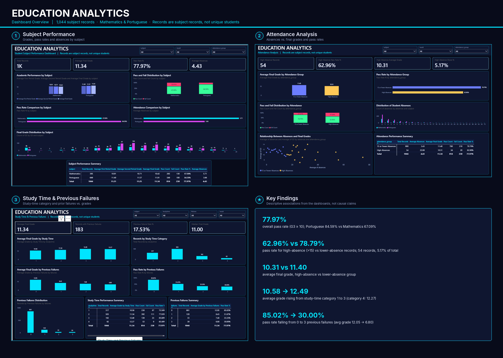
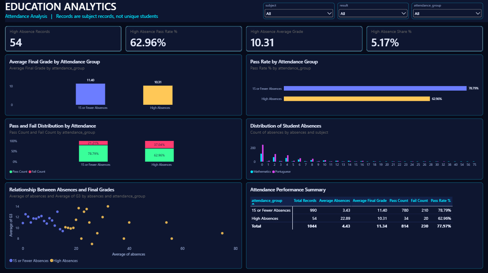
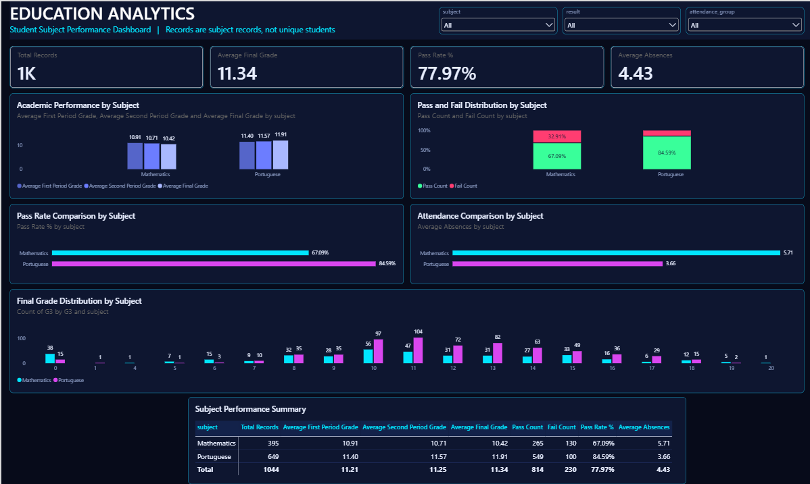
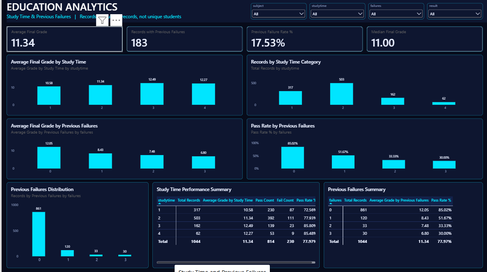

# Education Analytics – Student Performance Analysis


> **Project 02 of my Data Analyst Portfolio** – an end-to-end analysis of secondary-school student performance, from raw UCI data to statistical testing in Python and a three-page interactive Power BI dashboard.



---

## 1. Project Overview

This project analyses academic performance in **Mathematics** and **Portuguese** using the UCI *Student Performance* dataset. It investigates how final grades (G3) relate to prior grades, study-time category, previous failures, absences and subject, and communicates the results through interactive Power BI dashboards.

**Important dataset note:** the Mathematics file has 395 records and the Portuguese file has 649 records, giving **1,044 subject records**. The dataset has no reliable unique student identifier, and the same student may appear in both subject files. **The 1,044 rows are therefore subject records, not 1,044 unique students.**

## 2. Objectives

- Combine and prepare the Mathematics and Portuguese datasets for analysis.
- Compare academic performance and pass rates between the two subjects.
- Examine how absences, study-time category and previous failures relate to final grades.
- Quantify relationships using correlation analysis and test the subject difference statistically (Welch's t-test and Cohen's d).
- Present the findings in three interactive Power BI dashboard pages.

## 3. Project Highlights

| Metric | Value |
|---|---:|
| Subject records analysed | 1,044 (395 Mathematics + 649 Portuguese) |
| Columns after feature engineering | 36 (33 original + `subject`, `result`, `attendance_group`) |
| Overall pass rate (G3 ≥ 10) | 77.97% (814 pass / 230 fail) |
| Average final grade (G3) | 11.34 |
| Mathematics vs Portuguese pass rate | 67.09% vs 84.59% |
| Pass rate: 0 vs 1 previous failure | 85.02% vs 51.67% |
| Pass rate: ≤ 15 vs > 15 absences | 78.79% vs 62.96% |
| Power BI dashboard pages | 3 |

## 4. Dataset

- **Source:** [UCI Machine Learning Repository – Student Performance](https://archive.ics.uci.edu/dataset/320/student+performance)
- **Files used:** `student-mat.csv` (Mathematics) and `student-por.csv` (Portuguese)
- **Reference:** Cortez, P. & Silva, A. (2008). *Using Data Mining to Predict Secondary School Student Performance.* Proceedings of the 5th FUture BUsiness TEChnology Conference (FUBUTEC 2008).

## 5. Tools and Technologies

| Area | Tools |
|---|---|
| Analysis | Python, Jupyter Notebook, Pandas, NumPy |
| Visualisation (Python) | Matplotlib, Seaborn |
| Statistics | SciPy, Scikit-learn |
| Business intelligence | Power BI Desktop, DAX |
| Data format | CSV |

## 6. Project Workflow

```text
UCI datasets ──► Load & inspect ──► Clean & validate ──► Combine subjects ──► Feature engineering
 (mat + por)                                              (add subject)      (result, attendance_group)
                                                                                      │
Power BI dashboards ◄── Export analysis CSVs ◄── Statistical testing ◄── Descriptive & correlation analysis
```

1. Load and inspect both subject datasets.
2. Clean and validate the data.
3. Combine the datasets and add a `subject` label.
4. Create `result` (Pass/Fail) and `attendance_group` fields.
5. Run descriptive, correlation, attendance, study-time and previous-failures analysis.
6. Detect outliers with the IQR method.
7. Test the subject difference with Welch's t-test and calculate Cohen's d.
8. Export analysis tables as CSV files and build the Power BI dashboards.

## 7. Interactive Power BI Dashboards

### Page 1 – Subject Performance
Compares Mathematics and Portuguese on grades, pass and fail distribution, pass rate, grade distribution and absences.



### Page 2 – Attendance Analysis
Examines how high absence (more than 15 absences) is associated with grades and pass rates.



### Page 3 – Study Time and Previous Failures
Explores final grades and pass rates by study-time category and number of previous failures.



Full field-level documentation, DAX measures and validation are in [PowerBI_Dashboard_Documentation.md](Documentation/PowerBI_Dashboard_Documentation.md).

## 8. Key Findings

**Subject performance**

| Subject | Records | Avg G1 | Avg G2 | Avg G3 | Pass rate | Avg absences |
|---|---:|---:|---:|---:|---:|---:|
| Mathematics | 395 | 10.91 | 10.71 | 10.42 | 67.09% | 5.71 |
| Portuguese | 649 | 11.40 | 11.57 | 11.91 | 84.59% | 3.66 |

- Average Mathematics grades decline from G1 to G3, while Portuguese grades rise.

**Attendance**

| Attendance group | Records | Avg absences | Avg G3 | Pass rate |
|---|---:|---:|---:|---:|
| 15 or fewer absences | 990 | 3.43 | 11.40 | 78.79% |
| More than 15 absences | 54 | 22.89 | 10.31 | 62.96% |

- High-absence records are 5.17% of all records. The overall correlation between absences and G3 is weak (about −0.05), so the group gap should be read with care.

**Study time (ordinal categories, not hours)**

| Category | 1 | 2 | 3 | 4 |
|---|---:|---:|---:|---:|
| Average G3 | 10.58 | 11.34 | 12.49 | 12.27 |

**Previous failures**

| Previous failures | Records | Avg G3 | Pass rate |
|---|---:|---:|---:|
| 0 | 861 | 12.05 | 85.02% |
| 1 | 120 | 8.43 | 51.67% |
| 2 | 33 | 7.48 | 33.33% |
| 3 | 30 | 6.80 | 30.00% |

- Previous failures show the strongest negative correlation with G3 among the background variables (−0.383).
- Prior grades are the strongest correlates of the final grade (G2: +0.911, G1: +0.809).

## 9. Statistical Analysis Summary

| Test / measure | Result | Interpretation |
|---|---|---|
| Welch's independent t-test (Mathematics vs Portuguese G3) | t = −5.6664, p < 0.001 | Statistically significant difference at the 0.05 level |
| Cohen's d | −0.3925 | Small effect size; Mathematics mean is lower |
| Correlation with G3 | G2 +0.911, G1 +0.809, failures −0.383 | Strongest associations in the data |

Statistical significance shows that a difference is unlikely to be due to chance; effect size shows how large it is. All results are **descriptive associations and do not establish causation**.

## 10. Project Structure

```text
Project_02_Education_Analytics/
│
├── README.md
│
├── Dataset/
│   ├── student-mat.csv
│   └── student-por.csv
│
├── Python/
│   └── 01_Education_Data_Inspection.ipynb
│
├── PowerBI/
│   ├── Education_Analytics_Dashboard.pbix
│   ├── Education_Cleaned_Data.csv
│   ├── Subject_Performance.csv
│   ├── Attendance_Analysis.csv
│   ├── Study_Time_Analysis.csv
│   ├── Previous_Failures_Analysis.csv
│   └── Correlation_Matrix.csv
│
├── Documentation/
│   ├── Project_Objectives_and_Methodology.md
│   ├── Python_Analysis_and_Findings.md
│   ├── PowerBI_Dashboard_Documentation.md
│   └── Business_Insights_and_Conclusion.md
│
├── Screenshots/
│   ├── Dashboard_01_Subject_Performance.png
│   ├── Dashboard_02_Attendance_Analysis.png
│   ├── Dashboard_03_Study_Time_Failures.png
│   └── Dashboard_Overview.png
│
└── SQL/                      (reserved for future SQL work)
```

## 11. How to Run the Project

**Python analysis**

1. Install Python 3 and Jupyter, then install the libraries: `pip install pandas numpy matplotlib seaborn scipy scikit-learn jupyter`
2. Confirm `student-mat.csv` and `student-por.csv` are in the `Dataset/` folder.
3. Open `Python/01_Education_Data_Inspection.ipynb` in Jupyter and run all cells from top to bottom. Adjust file paths in the notebook if your folder location differs.

**Power BI dashboards**

1. Install Power BI Desktop (Windows).
2. Open `PowerBI/Education_Analytics_Dashboard.pbix`.
3. If Power BI cannot find the data, go to **Home → Transform data → Data source settings → Change Source** and point it to `PowerBI/Education_Cleaned_Data.csv` on your computer.
4. Click **Refresh** and use the slicers at the top of each page.

## 12. Skills Demonstrated

- **Python:** data loading, inspection, cleaning, merging, feature engineering, exploratory analysis
- **Statistics:** descriptive statistics, correlation, IQR outlier detection, Welch's t-test, effect size
- **Power BI:** data import, DAX measures, KPI cards, interactive multi-page dashboards, slicers, formatting
- **Analytical thinking:** separating statistical significance from practical importance; avoiding causal claims
- **Documentation:** structured, reproducible, recruiter-ready case study

## 13. Limitations

- Records are subject records, not unique students; the same student may appear in both subjects.
- Findings are observational associations, not proof of cause and effect.
- Study-time and failure fields are ordinal/discrete categories, not continuous measures.
- The high-absence group is small (54 records), so its averages are less stable.

## 14. Conclusion

Prior grades and previous failures are the strongest correlates of final performance in this dataset, Portuguese records show higher grades and pass rates than Mathematics records, and high absence is associated with lower average results. These findings point to where early academic support could be targeted, while remaining descriptive rather than causal.

## 15. Documentation Navigation

| Document | Purpose |
|---|---|
| [Project Objectives and Methodology](Documentation/Project_Objectives_and_Methodology.md) | Business problem, dataset, preparation and methods |
| [Python Analysis and Findings](Documentation/Python_Analysis_and_Findings.md) | Analysis steps, statistics and results |
| [Power BI Dashboard Documentation](Documentation/PowerBI_Dashboard_Documentation.md) | Data model, DAX, dashboard pages and validation |
| [Business Insights and Conclusion](Documentation/Business_Insights_and_Conclusion.md) | Insights, implications and recommendations |
