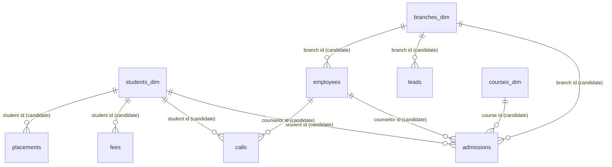

# 02 — Data Model and Relationships

> **Important limitation.** The PBIX stores its data model in a compressed section (`DataModel`) that could not be opened in this environment. Relationships, cardinality, filter direction and the date-table flag are therefore **not verified**. Evidence from the CSV files is shown instead and is labelled as *candidate*. To finish this file, please send a screenshot of **Model view** (or a Tabular Editor / DAX Studio metadata export).

## 1. Model tables

| # | Table | Role (🟡 inferred from structure) | Rows | Verified in report layout |
|---|---|---|---|---|
| 1 | admissions | Fact (one row per admission) | 2,000 | ✅ model table |
| 2 | calls | Fact (one row per call) | 18,226 | ✅ |
| 3 | fees | Fact (one row per student payment record) | 2,000 | ✅ |
| 4 | leads | Fact (one row per lead) | 2,000 | ✅ |
| 5 | marketing | Fact (one row per campaign) | 150 | ✅ |
| 6 | placements | Fact (one row per student placement record) | 2,000 | ✅ |
| 7 | students dim | Dimension | 2,000 | ✅ |
| 8 | branches dim | Dimension | 5 | ✅ |
| 9 | courses dim | Dimension | 5 | ✅ |
| 10 | employees | Dimension | 30 | ✅ |
| 11 | DateTable | Date dimension | 1,096 | ✅ |
| 12–16 | Revenue measures · student measures · lead measures · Call measures · Placement measures | Measure-only tables (hold DAX measures) | n/a | ✅ referenced by visuals |

## 2. Keys observed in the data

| Table | Candidate primary key | Unique? | Foreign keys present |
|---|---|---|---|
| admissions | admission id (student id also unique) | ✅ student id unique | student id, branch id, course id, counselor id |
| students dim | student id | ✅ | branch id, course id |
| branches dim | branch id | ✅ | none |
| courses dim | course_id | ✅ | none |
| employees | emp id | ✅ | branch id |
| fees | payment id (student id also unique) | ✅ student id unique | student id |
| placements | placement id (student id also unique) | ✅ student id unique | student id |
| leads | lead id | ✅ | branch id (no student id column) |
| calls | call id | ✅ | student id, counselor id |
| marketing | campaign id | ✅ | none (platform, campaign month are text) |
| DateTable | Date | ✅ (1,096 distinct dates) | none |

## 3. Candidate relationships (evidence from CSV key matching)

"Match" = every distinct value on the many side exists on the one side (no orphan keys).

| From (many) | To (one) | Distinct keys | Orphans | Status |
|---|---|---|---|---|
| admissions[student id] | students dim[student id] | 2,000 | 0 | 🟡 candidate |
| admissions[branch id] | branches dim[branch id] | 5 | 0 | 🟡 candidate |
| admissions[course id] | courses dim[course_id] | 5 | 0 | 🟡 candidate |
| admissions[counselor id] | employees[emp id] | 30 | 0 | 🟡 candidate |
| calls[student id] | students dim[student id] | 2,000 | 0 | 🟡 candidate |
| calls[counselor id] | employees[emp id] | 30 | 0 | 🟡 candidate |
| fees[student id] | students dim[student id] | 2,000 | 0 | 🟡 candidate |
| placements[student id] | students dim[student id] | 2,000 | 0 | 🟡 candidate |
| leads[branch id] | branches dim[branch id] | 5 | 0 | 🟡 candidate |
| employees[branch id] | branches dim[branch id] | 5 | 0 | 🟡 candidate |
| students dim[branch id] | branches dim[branch id] | 5 | 0 | 🟡 candidate |
| students dim[course id] | courses dim[course_id] | 5 | 0 | 🟡 candidate |

Matching keys prove a relationship is *possible*, not that it exists in the model. Several of these (for example both admissions → branches and students dim → branches) could create ambiguous paths; which are active is ⏳.

## 4. Points that need confirmation ⏳

| Observation | Why it matters |
|---|---|
| **placements has no date column**, yet the "Monthly Placement Trend" plots Placed Students by DateTable[YearMonth] | The month must reach placements through a relationship chain or DAX logic that cannot be read here. |
| **leads has no student id**, only branch id and lead source | Lead-to-admission linkage is not possible by key; "converted leads" must come from `lead status`. |
| **marketing has no key** to any other table | The *platform* slicer on the Executive page may not filter the other visuals unless a relationship or DAX handles it. |
| Cardinality, filter direction (single/both), active/inactive flags | Not readable — ⏳ |

## 5. Date table configuration

| Property | Value | Status |
|---|---|---|
| Columns | Date, Year, Month, MonthNo, Quarter, YearMonth | ✅ (CSV) |
| Date range | 2024-01-01 to 2026-12-31 (1,096 days, no gaps in row count vs. range) | ✅ |
| Example YearMonth format | `2024-Jan` | ✅ |
| Marked as date table in Power BI | ⏳ |
| Date columns it relates to (admission date, generated date, call date …) | ⏳ |
| Sorting of YearMonth by MonthNo/Date | ⏳ (YearMonth is text; check sort-by column) |

Data actually spans late 2023 to May 2025 (leads from 2023-11-25, calls from 2023-12-02, admissions 2024-01-01 to 2025-05-15), so the 2026 portion of the date table is empty of facts.
