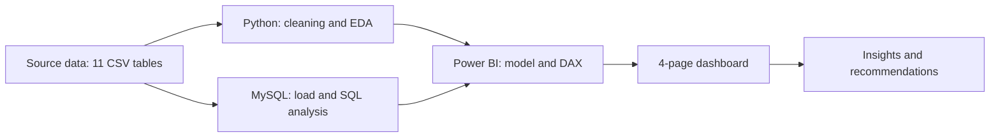

# Education 360° — Education Business Analytics: Project Overview

> Legend — ✅ verified from the supplied files · 🟡 inferred (please confirm) · ⏳ PENDING

## 1. Introduction

Education 360° is an end-to-end data analytics project on an academy (education training institute) with multiple branches. It combines admissions, leads, calls, fees, marketing, placements, student and employee data into a four-page Power BI report, supported by Python and MySQL analysis. The project originates from academy training work and is presented here as a portfolio piece.

## 2. Business background 🟡

The data describes an institute selling five technology courses (Java Full Stack, Python Full Stack, Data Science, Data Analytics, Software Testing) across five branches (Karve Nagar, Hadapsar, Chinchwad, Nagpur, Pimpri). Revenue depends on converting leads into admissions, collecting fees, and placing students after training.

## 3. Problem statement 🟡

Management needs one consistent view of the student lifecycle — lead → call → admission → fee payment → placement — to see where the business gains or loses students and money. ⏳ The original brief is not among the files; please confirm or replace this statement.

## 4. Project objectives 🟡

1. Measure revenue, fee collection and outstanding fees.
2. Measure lead generation and conversion by source and branch.
3. Evaluate counselor call activity and effectiveness.
4. Track placement rate, salary and hiring companies.
5. Present results in an executive-friendly Power BI report.

## 5. Business requirements ⏳

Formal requirements were not supplied. The report answers the information needs listed in `PowerBI/01_PowerBI_Project_Overview.md`.

## 6. Scope of analysis

| Area | Data | Included |
|---|---|---|
| Admissions & students | admissions, students dim | ✅ |
| Sales & leads | leads, calls, employees, marketing | ✅ |
| Placements | placements | ✅ |
| Finance | fees, admissions | ✅ |
| Reference | branches dim, courses dim, DateTable | ✅ |

Dataset period: leads from Nov 2023, admissions Jan 2024 – May 2025 (✅). Out of scope: course content quality, student satisfaction, costs other than marketing ad spend.

## 7. Technology stack

| Tool | Role | Evidence |
|---|---|---|
| Power BI + DAX | Reporting and measures | ✅ PBIX supplied |
| Python (Pandas, NumPy, Matplotlib, Seaborn) | Cleaning, EDA, visuals | ⏳ notebooks not yet supplied |
| MySQL 8.0 / SQL | Database and analysis queries | ⏳ scripts not yet supplied |
| GitHub | Portfolio hosting | — |

## 8. Project workflow

The order of the Python, SQL and Power BI stages is ⏳ to confirm.

## 9. Expected business value 🟡

Faster visibility of revenue and outstanding fees, identification of high-converting lead sources and branches, targeted counselor coaching, and monitoring of placement outcomes.

## 10. Documentation map

| File | Status |
|---|---|
| Data_Dictionary.md | Complete (from CSVs) |
| Data_Cleaning_and_Preparation.md | Partly complete — prior cleaning ⏳ |
| Python_Analysis.md | Pending notebooks |
| SQL_Analysis.md | Pending SQL scripts |
| Business_Insights_and_Recommendations.md | Data profile only — analysis results ⏳ |
| Methodology.md | Partly complete |
| PowerBI/01–08 | Complete where verifiable; DAX and relationships ⏳ |
