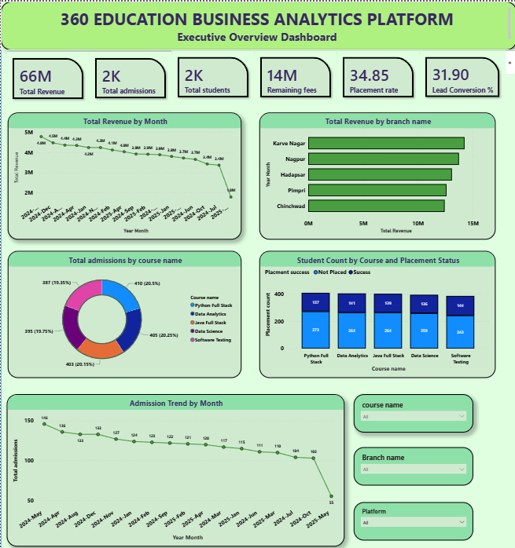
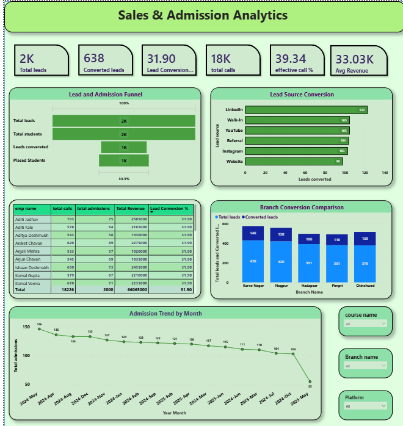
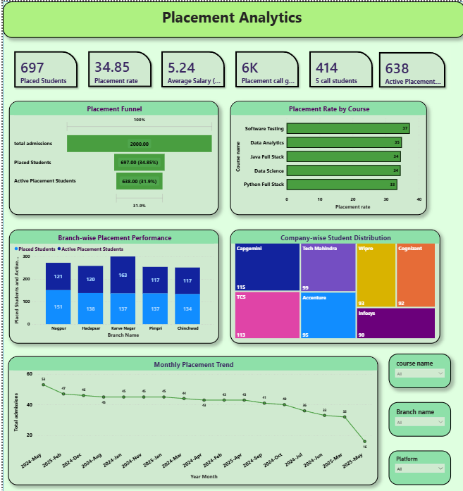
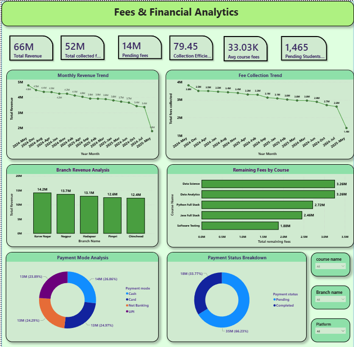

# Education 360° — Business Analytics

An end-to-end education business analytics project using Python, MySQL, Power BI and DAX to analyze admissions, marketing, placements and financial performance.

## Project Overview

Education 360° provides a comprehensive view of an education academy's business performance. The project transforms multiple datasets into meaningful business insights through data analysis, SQL queries and interactive Power BI dashboards.

## Objectives

- Analyze student admissions and enrollment trends.
- Evaluate branch-wise and course-wise performance.
- Understand marketing campaigns and lead activity.
- Measure student placement outcomes.
- Monitor revenue, fee collection and outstanding balances.
- Build interactive dashboards for business decision-making.

## Technology Stack

 Technology  Purpose 
------
 Python  Data inspection, cleaning and EDA 
 MySQL 8.0  Database management and SQL analysis 
 Power BI  Interactive dashboards 
 DAX  KPI calculations and business measures 
 DAX Studio  DAX measure validation 
 GitHub  Project documentation and version control 

## Dashboard Pages

### 1. Executive Overview

Provides a consolidated overview of admissions, revenue, students, placement performance and branch performance.

### 2. Sales & Admission Analytics

Analyzes leads, admissions, lead sources, calls, branch comparisons and monthly admission trends.

### 3. Placement Analytics

Explores placed students, placement rates, salary packages, branch performance and company-wise placement distribution.

### 4. Fees & Financial Analytics

Analyzes billed revenue, collected fees, outstanding balances, collection efficiency and payment methods.

## Key Business KPIs

 KPI  Value 
------
 Total Students  2,000 
 Total Admissions  2,000 
 Total Billed Revenue  ₹6.61 Crore 
 Fees Collected  ₹5.25 Crore 
 Outstanding Fees  ₹1.36 Crore 
 Collection Efficiency  79.45% 
 Placed Students  697 
 Overall Recorded Placement Rate  34.85% 
 Average Salary Package  ₹5.24 LPA 
 Marketing Leads Generated  39,934 

## Key Insights

- The academy recorded ₹5.25 crore in fee collections.
- Collection efficiency stands at 79.45%.
- A total of 697 students have recorded placement status as Placed.
- Karve Nagar branch has the highest recorded branch revenue.
- Data Science has the highest remaining fee balance.
- Marketing campaign data provides aggregate lead-generation and admission-conversion insights.

## SQL Analysis

The project includes nine SQL scripts covering

1. Database Setup
2. Data Exploration
3. Data Quality Checks
4. Student Admissions Analysis
5. Marketing & Lead Analysis
6. Placement Analytics
7. Financial Analytics
8. Advanced Business Analysis
9. KPI Summary

SQL concepts include JOINs, GROUP BY, HAVING, CASE WHEN, subqueries, CTEs, RANK, DENSE_RANK, ROW_NUMBER, LAG, LEAD and running totals.

## Important Data Limitations

- Individual lead-to-admission conversion cannot be reliably established without a validated matching key.
- Marketing conversion metrics represent campaign-level aggregate data.
- Placement rate uses all recorded students as the denominator, not a separately identified eligible-student population.
- Monthly financial analysis uses admission date because the fees dataset does not contain a payment date.
- Student personal information is excluded from public project uploads.

## Project Outcome

This project demonstrates practical skills in data analysis, database querying, business intelligence, KPI development and interactive dashboard creation.

It showcases an end-to-end analytics workflow, from raw data inspection to business reporting and visualization.